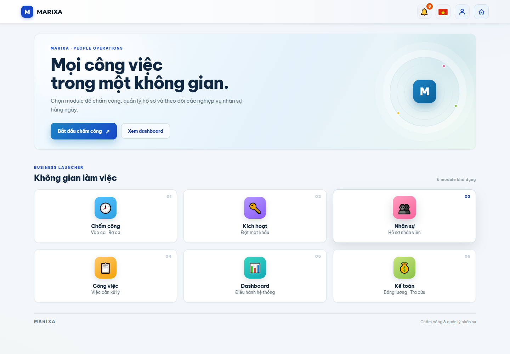
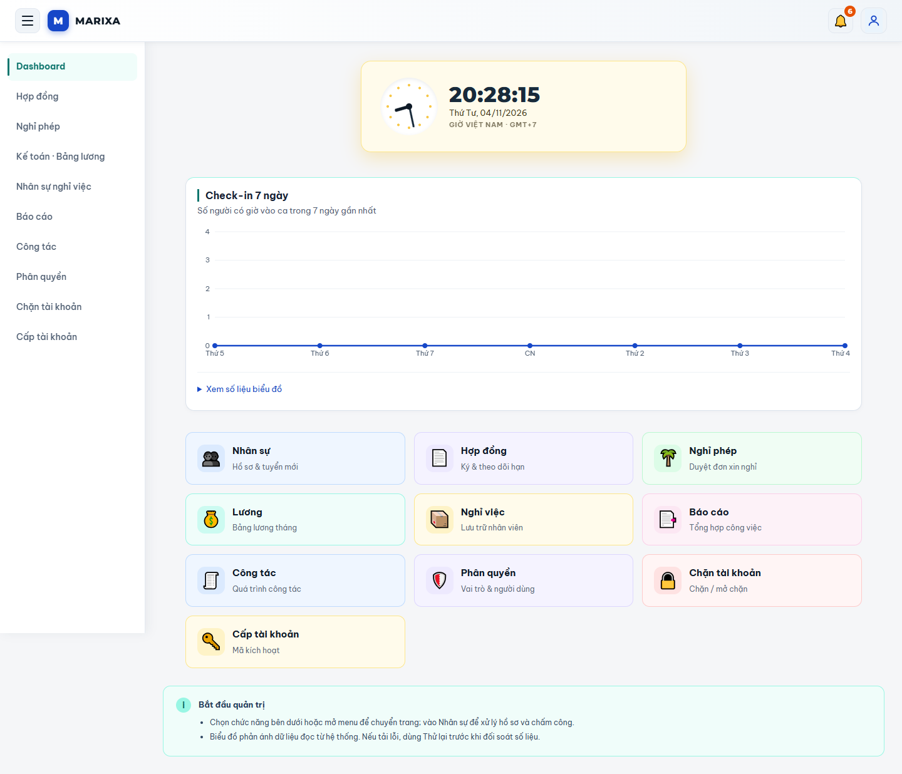
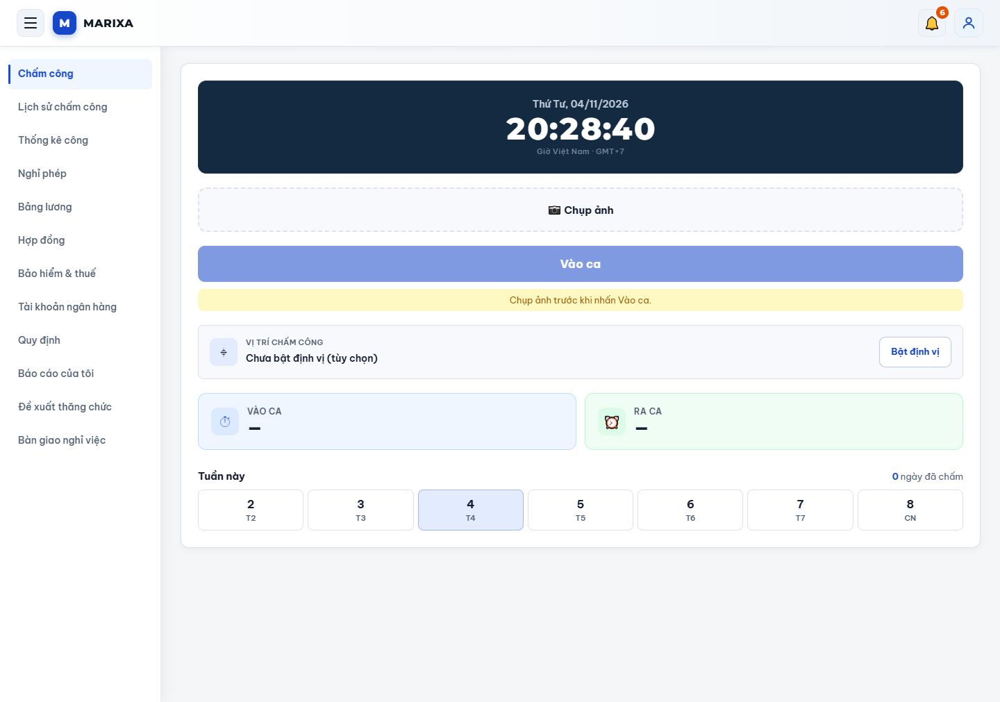
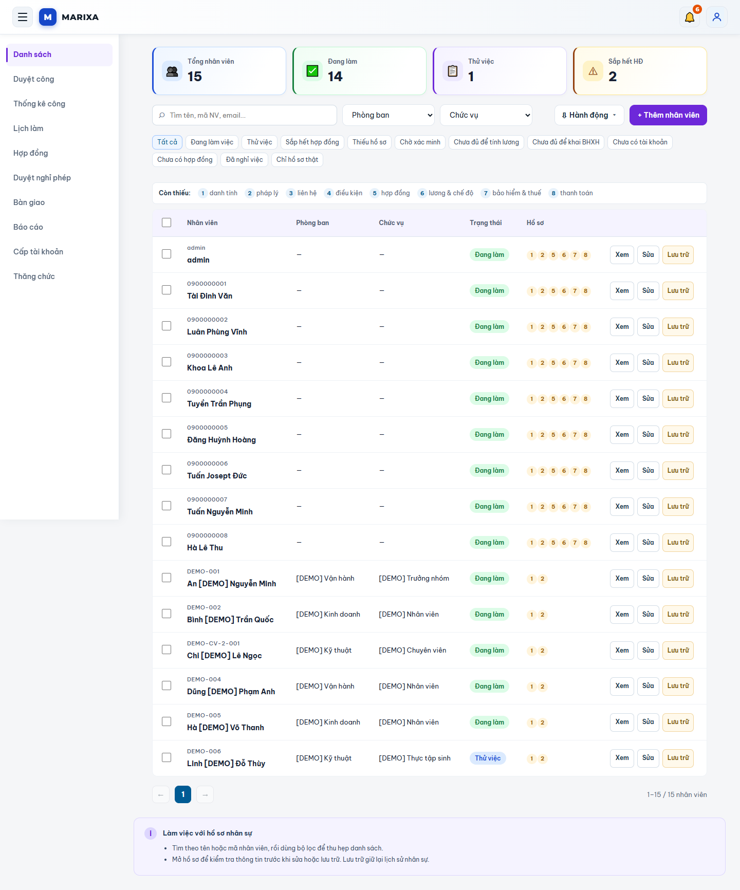
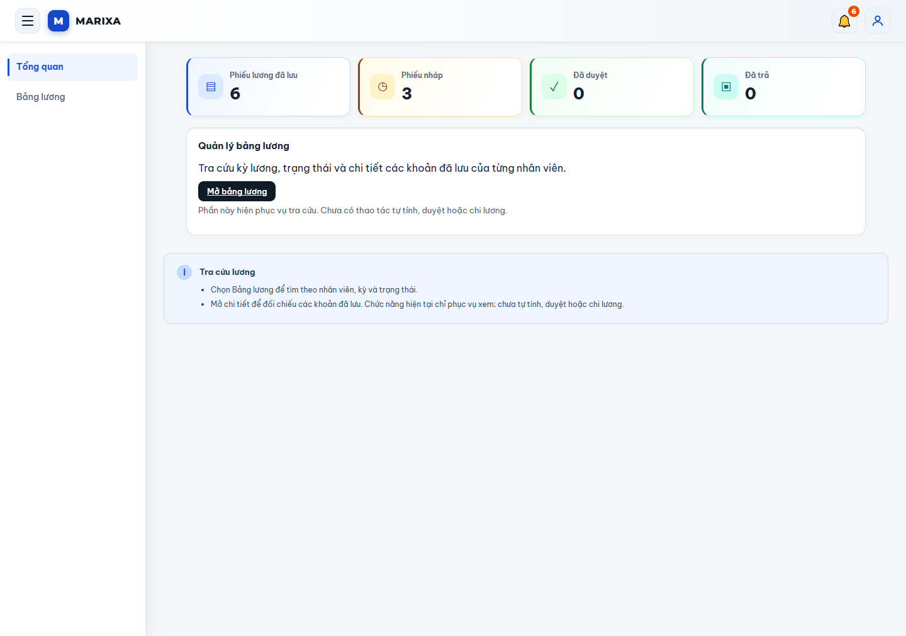
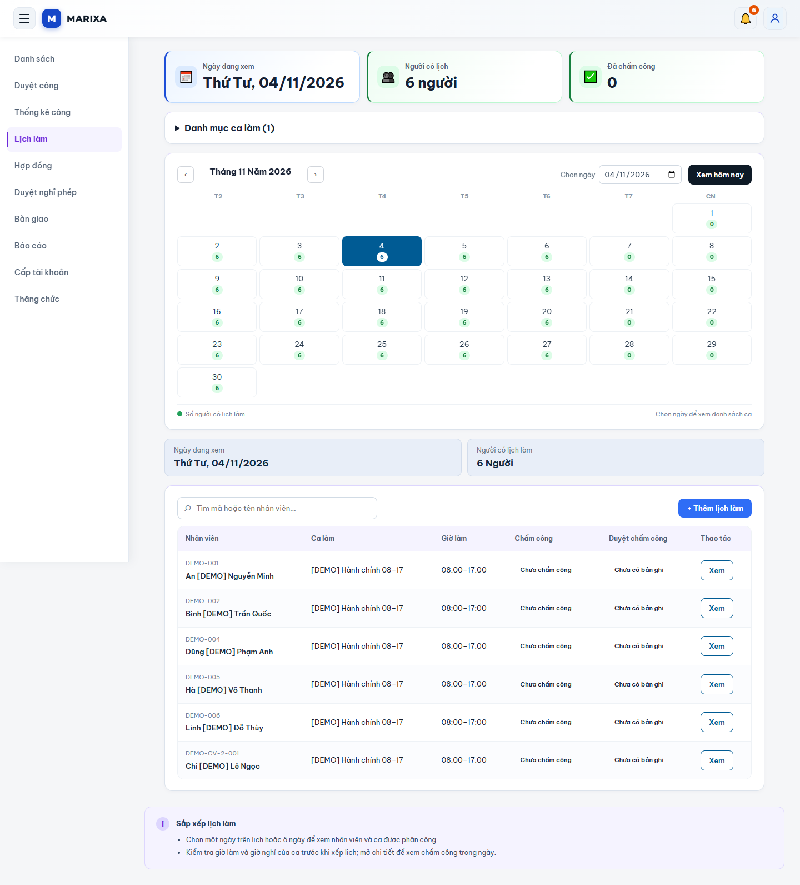
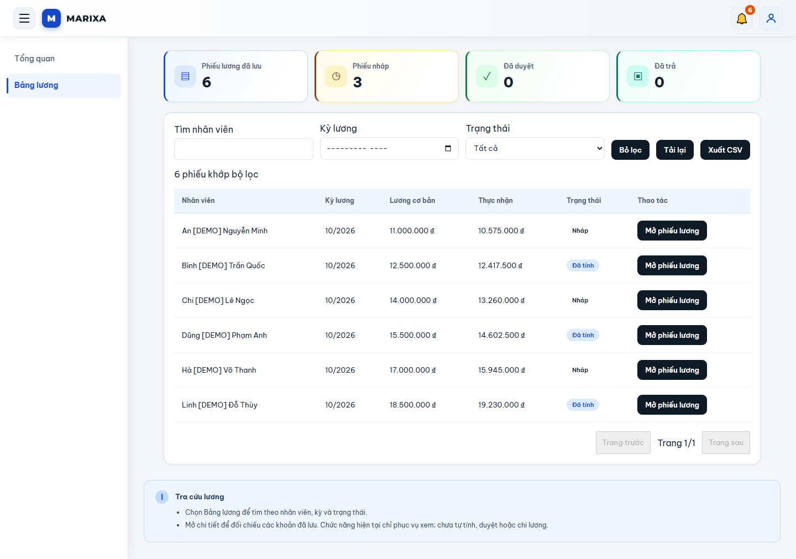
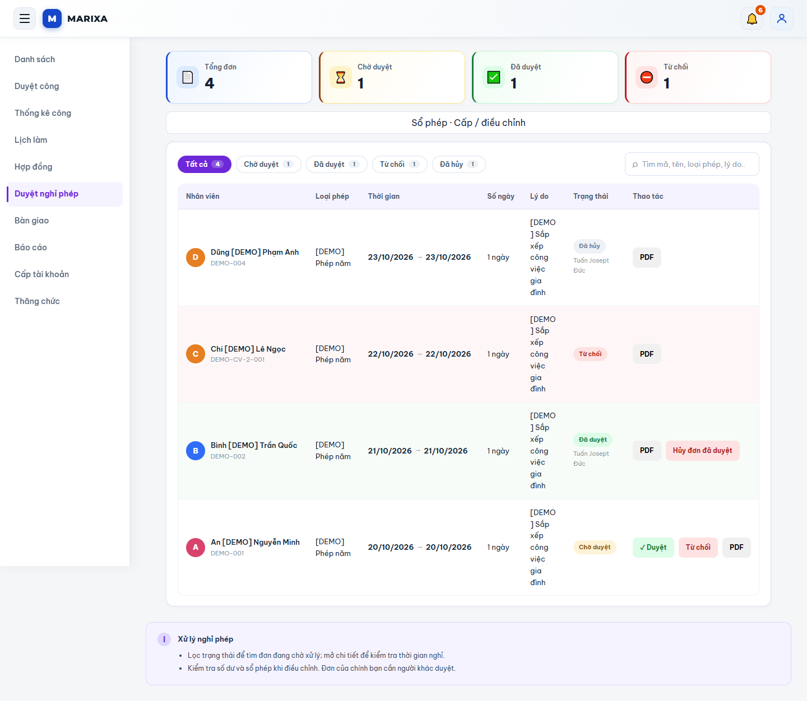
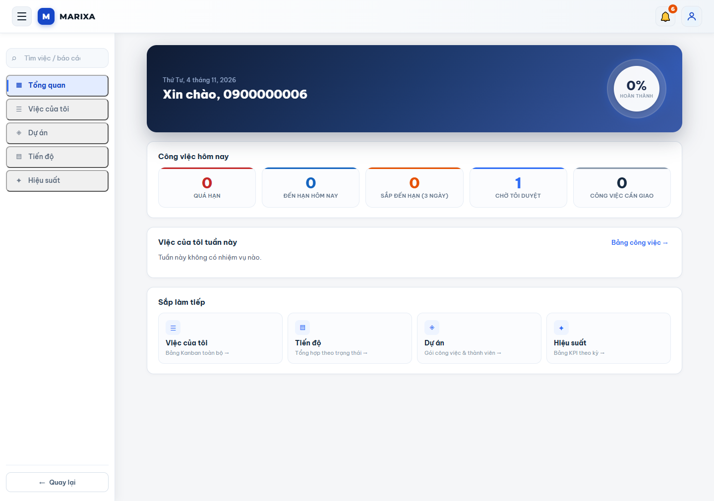

# MARIXA — Quản lý nhân sự & chấm công

Ứng dụng quản lý nhân sự, chấm công theo ca, nghỉ phép và bảng lương cho doanh nghiệp. Dự án full-stack sử dụng **React · Vite · ASP.NET Core 8 · Entity Framework Core**, tập trung vào phân quyền, quy trình phê duyệt và bảo toàn lịch sử nghiệp vụ.

**[Mở bản demo](https://marixa001.vercel.app/)** · [Ảnh từng chức năng](docs/FEATURE-TOUR.md) · [Hướng dẫn frontend](marixa_react/README.md) · [API & nâng cấp backend](docs/15-api-contract.md)



## Thử ngay — dành cho người xem dự án

Mở **[MARIXA demo](https://marixa001.vercel.app/)**. Bộ tài khoản mẫu bên dưới được chủ dự án cho phép công khai để trải nghiệm; đăng nhập bằng **mã tài khoản**, không bắt buộc nhập email.

| Vai trò | Tài khoản | Mật khẩu | Kiểm tra demo 04/11/2026 |
| --- | --- | --- | --- |
| Nhân viên | `0900000001` | `Hovaten123@` | Đăng nhập thành công |
| Nhân viên | `0900000002` | `Hovaten123@` | API đăng nhập thành công |
| Nhân sự (HR) | `0900000003` | `Hovaten123@` | Đăng nhập thành công |
| Nhân sự (HR) | `0900000004` | `Hovaten123@` | API đăng nhập thành công |
| Quản lý | `0900000005` | `Hovaten123@` | Đăng nhập thành công |
| Quản trị | `0900000006` | `Hovaten123@` | Đăng nhập thành công |
| Kế toán | `0900000007` | `Hovaten123@` | Demo từ chối thông tin đăng nhập |
| Kế toán | `0900000008` | `Hovaten123@` | API đăng nhập thành công |

Dùng cửa sổ ẩn danh hoặc các trình duyệt khác nhau để trải nghiệm nhiều vai trò. Máy chủ API trên Render có thể cần thời gian khởi động; giữ trang mở khi xuất hiện thông báo “Đang kết nối đến Marixa”. Tài khoản Admin đã kiểm tra có thể mở khu kế toán để xem bảng lương khi tài khoản kế toán chưa đăng nhập được.

Đây là bộ tài khoản dùng chung cho dự án trình diễn. Không nhập thông tin nhân sự thật, thay đổi mật khẩu, khóa tài khoản mẫu hoặc xóa dữ liệu của người thử khác. Chưa xác nhận có cơ chế tự reset dữ liệu hay giới hạn thao tác riêng cho demo.

## Kịch bản trải nghiệm 5 phút

1. Đăng nhập **Nhân viên** (`0900000001`): từ Không gian làm việc, mở **Chấm công**. Xem giờ, trạng thái vào/ra ca và lịch tuần; thao tác chụp ảnh/định vị phụ thuộc quyền thiết bị. Chấm vào/ra sẽ ghi dữ liệu dùng chung.
2. Mở **Lịch sử chấm công**, **Thống kê công**, **Nghỉ phép**, **Hợp đồng** và **Bảng lương** để khảo sát không gian cá nhân.
3. Ở cửa sổ khác, đăng nhập **HR** (`0900000003`) hoặc **Admin** (`0900000006`), mở **Nhân sự**. Tìm nhân viên, lọc theo phòng ban, trạng thái và mức độ đầy đủ hồ sơ.
4. Xem **Lịch làm**, **Duyệt công**, **Duyệt nghỉ phép** và **Hợp đồng**. Khi thử tạo hoặc duyệt dữ liệu, dùng nội dung mẫu và kiểm tra đúng người/đúng kỳ trước khi lưu.
5. Với **Admin**, mở **Dashboard** để xem biểu đồ check-in và các lối tắt quản trị; khảo sát phân quyền, cấp tài khoản và báo cáo.
6. Mở module **Kế toán** → **Bảng lương** để tra cứu theo kỳ, nhân viên và trạng thái. Bản demo kiểm tra hiện phục vụ xem dữ liệu đã lưu; chưa cung cấp thao tác tự tính, duyệt hoặc chi lương trên màn hình này.
7. Mở **Công việc** để xem module quản lý công việc. Thử thu nhỏ trình duyệt hoặc mở bằng điện thoại để xem bố cục mobile.

Các ảnh được chụp từ demo ngày **04/11/2026**. Đợt kiểm tra chỉ đăng nhập và xem các màn hình, chưa kiểm thử thao tác ghi nghiệp vụ. Main hiện dùng các route `/hr`, `/me`, `/accounting` và giữ alias cho các đường dẫn cũ.

## Các chức năng hiện có

| Nhóm | Hành vi |
| --- | --- |
| Nhân sự | Hồ sơ, phòng ban, chức vụ, hợp đồng, thông tin bảo hiểm/thuế, ngân hàng, thăng chức và bàn giao |
| Tài khoản & quyền | Identity/JWT, cấp và kích hoạt tài khoản, vai trò, khóa tài khoản, giới hạn dữ liệu theo quyền |
| Ca & lịch làm | Gán ca cho một hoặc nhiều nhân viên, tối đa 31 ngày mỗi lượt, tùy chọn bỏ Chủ nhật; quản lý ca bởi HR/Admin |
| Chấm công | Chụp ảnh, vào/ra ca, lịch sử và thống kê; GPS hiển thị trên giao diện, chưa có geofence hoàn chỉnh |
| Yêu cầu | Nghỉ phép, tăng ca riêng và điều chỉnh công; xử lý theo quyền và quy tắc nghiệp vụ |
| Kỳ công | Review, khóa/mở lại có lý do, snapshot có phiên bản/hash, xuất XLSX theo quyền |
| Nghỉ phép | Duyệt, hủy đơn đã duyệt có lý do/hoàn phép theo quyền; cấp và điều chỉnh phép thủ công |
| Kế toán | Admin/Accountant tra cứu bảng lương đã lưu, tìm/lọc theo nhân viên, kỳ và trạng thái; xem chi tiết |
| Công việc | Tổng quan, việc cá nhân, dự án, tiến độ, hiệu suất và báo cáo |
| Tiện ích | Thông báo có liên kết xử lý, PDF đơn nghỉ, import/export hồ sơ và giao diện responsive |

Bảng tóm tắt dựa trên tài liệu main và các màn hình đã khảo sát. Phạm vi đã kiểm chứng và các việc còn mở nằm trong [worklog](docs/worklog.md) và [kế hoạch](docs/01-plan.md).

## Điểm kỹ thuật

- React 19/Vite, React Router và Axios; mã frontend chia theo module nghiệp vụ và các thành phần dùng chung.
- ASP.NET Core 8 tách controller, service, repository, contract và core; Entity Framework Core hỗ trợ SQL Server/PostgreSQL.
- ASP.NET Identity/JWT giữ vai trò nguồn xác thực ứng dụng. API kiểm tra quyền dữ liệu; bảo vệ route phía frontend không thay thế kiểm tra ở server.
- Kỳ công dùng snapshot/version/hash; các thay đổi ảnh hưởng tháng đã khóa được kiểm soát ở persistence. XLSX/PDF được xuất qua luồng có phân quyền.
- Ảnh chấm công sử dụng Storage public hoặc nhánh lưu đĩa theo cấu hình hiện hành; tài liệu HR có luồng riêng tư. Xem [bảo mật và quyền riêng tư](docs/16-security-privacy.md).
- Session không chọn Ghi nhớ đăng nhập dùng sessionStorage; có chọn dùng localStorage. Không lưu mật khẩu trong phiên frontend.
- Có bộ kiểm thử backend cô lập, Node test runner frontend và CI. Kết quả lịch sử được ghi riêng trong worklog; không xem build/test cô lập là nghiệm thu production.

## Ảnh giao diện

| Quản trị & nhân sự | Chấm công & kế toán |
| --- | --- |
|  |  |
|  |  |
|  |  |
|  |  |

[Thư viện ảnh đầy đủ: đăng nhập, không gian làm việc, quản trị, nhân sự, hợp đồng, lịch làm, nghỉ phép, kế toán và mobile](docs/FEATURE-TOUR.md). Ảnh chụp từ demo ngày **04/11/2026**, không phải mockup. Các màn hình nghiệp vụ chủ yếu được mở bằng tài khoản Admin mẫu.

## Chưa áp dụng / hướng phát triển

| Hạng mục | Trạng thái |
| --- | --- |
| Tự tính, duyệt và chi lương | Module Kế toán hiện chỉ tra cứu; chưa có payroll engine đầy đủ |
| Phép tự động định kỳ | Hiện cấp/điều chỉnh thủ công; chính sách tự động còn cần xác nhận |
| GPS/geofence | Có giao diện vị trí; chưa nghiệm thu luồng lưu tọa độ/kiểm tra bán kính đầy đủ |
| Offline queue và điều chỉnh kỳ sau | Chưa có luồng hoàn chỉnh; không coi retry giao diện là hàng đợi offline bền vững |
| Múi giờ đa quốc gia | Đường chạy hiện hành dùng giờ Việt Nam; chưa có phạm vi vận hành đa quốc gia đã nghiệm thu |
| Tài khoản demo | `0900000007` bị từ chối với mật khẩu seed; tài khoản kế toán `0900000008` đăng nhập API thành công |
| Camera/GPS, nghiệp vụ ghi và thiết bị thật | Chưa kiểm thử trong lần cập nhật README này |
| Backup/restore và vận hành | Xem phạm vi bằng chứng, rủi ro và tiêu chí phát hành trong tài liệu chuyên trách |

Không coi các mục tiêu thiết kế là chức năng đã hoàn thành. [Kế hoạch](docs/01-plan.md), [rủi ro](docs/34-risks-changes.md) và [worklog](docs/worklog.md) ghi rõ phạm vi hiện hành.

## Chạy local

Yêu cầu **.NET SDK 8**, **Node.js/npm** tương thích lockfile Vite và **database phát triển riêng**. Hướng dẫn đầy đủ về môi trường, schema, bootstrap và tác động startup tại [thiết lập local](docs/10-setup-local.md) và [chuẩn cấu hình](docs/CONFIGURATION-STANDARD.md).

Backend, từ thư mục gốc repository:

```powershell
cd marixa_aspnet
dotnet restore M.BE.sln
# Cấu hình database/JWT riêng theo docs/10-setup-local.md trước khi chạy API.
dotnet run --project M.API/M.API.csproj --launch-profile M.API --urls http://localhost:57432
```

Frontend, mở terminal khác từ thư mục gốc:

```powershell
cd marixa_react
npm ci
npm run dev
```

Mở địa chỉ Vite hiển thị trong terminal. API HTTP mặc định `http://localhost:57432`; Vite proxy `/api` và `/uploads` tới backend local. Xem [README React](marixa_react/README.md) và [setup local](docs/10-setup-local.md) trước khi override proxy hoặc dùng API khác origin.

Cấu hình riêng qua biến môi trường/User Secrets; không commit connection string hoặc JWT key. Development có thể init/seed theo cấu hình, vì vậy không trỏ thử nghiệm tới database live. Tài khoản/mật khẩu demo phía trên không phải cam kết tài khoản local sẽ tự có sẵn.

Kiểm tra backend, trong `marixa_aspnet`:

```powershell
dotnet build M.BE.sln -c Release --no-restore -warnaserror
dotnet test M.BE.sln -c Release --no-build
```

Kiểm tra frontend, trong `marixa_react`:

```powershell
npm test
npm run lint
npm run build
```

Các lệnh trên là hướng dẫn tái kiểm tra; lần cập nhật README này không chạy lại build/test ứng dụng. Xem [chiến lược và bằng chứng kiểm thử](docs/06-testing.md).

## Tài liệu dự án

| Tài liệu | Nội dung |
| --- | --- |
| [Chỉ dẫn tài liệu](docs/00-README.md) | Điểm bắt đầu, nguồn chuẩn và hosting |
| [Kế hoạch & quyết định](docs/01-plan.md) | Phạm vi, quyết định hiện hành và backlog |
| [Kiến trúc](docs/03-architecture.md) · [ADR](docs/14-architecture-decisions.md) | Cấu trúc hệ thống và quyết định kỹ thuật |
| [API](docs/15-api-contract.md) · [Bảo mật](docs/16-security-privacy.md) | Hợp đồng và phân quyền |
| [Setup local](docs/10-setup-local.md) · [Cấu hình](docs/CONFIGURATION-STANDARD.md) | Chạy và cấu hình môi trường |
| [Hướng dẫn sử dụng](docs/30-user-guide.md) | Các luồng dành cho người dùng |
| [Migration](docs/23-data-migration.md) · [Backup/restore](docs/22-backup-recovery.md) | Chuẩn bị dữ liệu và phục hồi |
| [Release checklist](docs/18-release-checklist.md) · [Worklog](docs/worklog.md) | Điều kiện phát hành và bằng chứng công việc |

## Cấu trúc repository

| Thư mục / tệp | Nội dung |
| --- | --- |
| `marixa_react/` | React/Vite, module giao diện và Node tests |
| `marixa_aspnet/M.API/` | API, xác thực và cấu hình ứng dụng |
| `marixa_aspnet/M.Services/` | Service nghiệp vụ |
| `marixa_aspnet/M.Repositories/` | EF Core, repository và migration |
| `marixa_aspnet/M.Contract.*/`, `M.ModelViews/`, `M.Core/` | Entity, contract, DTO và tiện ích |
| `marixa_aspnet/M.Tests/` | Kiểm thử backend |
| `docs/` | Tài liệu, worklog và ảnh chức năng |
| `scripts/`, `deploy/`, `render.yaml` | Công cụ và cấu hình triển khai |
| `.github/workflows/` | CI |
| `figma/` | Tài nguyên phục vụ đồng bộ thiết kế |

Tác giả: [Đinh Văn Tài](https://github.com/taiDinh303) và [thankiemsama](https://github.com/thankiemsama).
