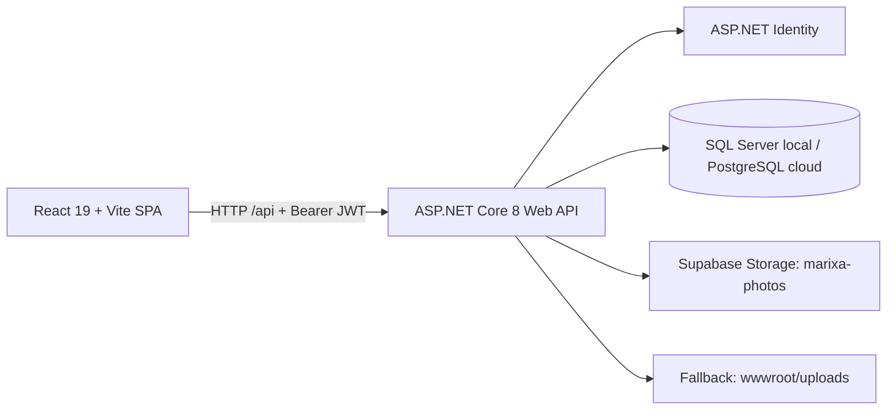

# 03 — Kiến trúc hệ thống Marixa

> Chủ tài liệu: **Đinh Văn Tài**. Đối chiếu mã nguồn: **17/10/2026**.
> **CURRENT** = có trong checkout; **TARGET** = thiết kế cần đạt; **NOT VERIFIED** = chưa kiểm tra runtime/hạ tầng. Có mã nguồn không đồng nghĩa đã nghiệm thu production.
> **EN — Codex / Agnes:** Read [00-README.md](00-README.md) first. Treat source links below as implementation evidence, not proof of production behavior. Preserve owner decisions; record security or architecture changes before implementation.

## 1. Thành phần và đường chạy hiện tại



| Thành phần | CURRENT — mã nguồn / cấu hình | Giới hạn xác minh |
| --- | --- | --- |
| Frontend | [`marixa_react/package.json`](../marixa_react/package.json): React 19, React Router 7, Vite 6; build static vào `dist/`. | Chưa chạy build/browser trong lượt chuẩn hóa tài liệu. |
| Backend | [`M.API/Program.cs`](../marixa_aspnet/M.API/Program.cs): controllers, EF Core, Identity/JWT, Swagger, static files, middleware lỗi. | Không khẳng định API đang truy cập được trên hosting. |
| CSDL | [`DatabaseConfig.cs`](../marixa_aspnet/M.API/Configuration/DatabaseConfig.cs): chọn provider qua `Database:Provider`, kết nối qua `ConnectionStrings:MyCnn`. | DB/schema live chưa đọc. |
| Ảnh chấm công | [`SupabasePhotoStorage.cs`](../marixa_aspnet/M.API/Storage/SupabasePhotoStorage.cs): khi đủ URL/service key, upload vào bucket public `marixa-photos`; thiếu cấu hình thì [`UploadController`](../marixa_aspnet/M.API/Controllers/Files/UploadController.cs) lưu đĩa local. | Không suy ra bucket/quyền live từ tên bucket trong code. |
| Triển khai | Cấu hình dự án dùng Render cho API, Vercel cho SPA, Supabase cho PostgreSQL/Storage. | Instance và cấu hình triển khai xem [08](08-deploy-detail.md), [11](11-setup-cloud.md); trạng thái online chưa kiểm tra. |

Frontend dùng [`apiConfig.js`](../marixa_react/src/services/api/apiConfig.js): `VITE_API_BASE_URL` nếu có, mặc định `/api`. Local có Vite proxy; triển khai web/API khác origin cần CORS đúng origin. [`axiosClient.js`](../marixa_react/src/services/api/axiosClient.js) đính Bearer token từ `marixa_auth`: sessionStorage nếu không Ghi nhớ, localStorage nếu có. JWT hết hạn hoặc 401 của đúng phiên xóa auth và về `/login`; 401 đến muộn của token cũ không xóa phiên mới.

Ứng dụng dùng **ASP.NET Identity + JWT**, không dùng Supabase Auth cho phiên đăng nhập hiện tại. `marixa_aspnet/web` (Next.js cũ) đã bị xóa khỏi checkout; SQL/RPC của kiến trúc cũ không phải bằng chứng API .NET đang thực thi quy tắc đó.

## 2. Ranh giới mã nguồn

Quyết định URL 19/10/2026: nhóm cá nhân dùng `/me/*`, nhân sự dùng `/hr/*`; Home `/home` và Admin `/admin/*` giữ nguyên. Các URL cũ `/attendance/*` và `/employees/*` chuyển hướng bằng replace sang prefix mới, giữ query/hash. Guard chuẩn hóa alias trước khi so quyền; đổi URL không mở quyền HR cho Employee. Đây là đổi route SPA, không đổi endpoint `/api/Attendance` hoặc `/api/Employee`.

| Project / thư mục | Trách nhiệm |
| --- | --- |
| `marixa_aspnet/M.API` | HTTP/DI/auth/bootstrap/adapters; controller nghiệp vụ gọi service, multipart forms giữ tại API. |
| `M.Contract.Services`, `M.Services` | Interface và xử lý nghiệp vụ/service, JWT, tính công. |
| `M.Contract.Repositories`, `M.Repositories` | Entity, repository/unit of work, EF `DatabaseContext`, migration. |
| `M.ModelViews`, `M.Core` | DTO request/response, phân trang, lỗi, hằng số dùng chung. |
| `marixa_react/src/modules` | Các module `login`, `activate`, `home`, `me`, `hr`, `admin`, `work`, `profile`, `unauthorized`. |
| `marixa_react/src/components`, `services`, `utils` | Layout/component dùng chung, API/auth/permission và tiện ích thời gian. |

Controllers hiện có bao phủ Identity/account, HR (nhân viên/phòng ban/chức vụ/hợp đồng/lương/bảo hiểm/thân nhân/ca/tài khoản ngân hàng), attendance/log/rule/correction, leave/ledger/OT, báo cáo/audit, work project/task/performance, payroll và danh mục. **Controller tồn tại chỉ xác nhận có bề mặt API**, không xác nhận toàn bộ UI, quyền hay quy tắc nghiệp vụ hoàn tất. Trạng thái theo module: [worklog.md](worklog.md); việc cần làm: [01-plan.md](01-plan.md).

Chi tiết dependency/OOP và feature tree: [backend ARCHITECTURE](../marixa_aspnet/ARCHITECTURE.md). Các service nghiệp vụ dùng BaseService; report/promotion/handover không còn DbContext trong controller.

## 3. Route frontend và quyền hiện tại

Nguồn route: [`App.jsx`](../marixa_react/src/App.jsx). Nguồn hiển thị module: [`modules.js`](../marixa_react/src/constants/modules.js). Inventory từng màn hình dùng cho thiết kế nằm ở [`figma/files-map.md`](../figma/files-map.md).

| Nhóm | Route hiển thị hiện có | Quyền / guard trong mã nguồn |
| --- | --- | --- |
| Public / tổng quan | `/login`, `/kich-hoat`, `/unauthorized`; `/home` cần phiên | `RequireSession` bọc các route nội bộ, public nằm ngoài wrapper. |
| Cá nhân `me` | `/me`, `/me/attendance-history`, `/me/attendance-rules`, `/me/statistics`, `/me/leave`, `/me/contracts`, `/me/salary`, `/me/insurance`, `/me/bank-accounts` | Registry khai báo `access: user`; các route này không bọc `RequireModule` tại `App.jsx`. |
| Cá nhân có wrapper | `/me/reports`, `/me/promotions`, `/me/handover`, `/work` | Bọc `RequireModule`, registry là `access: user`. |
| Hồ sơ | `/profile` | Registry `access: user`, không bọc `RequireModule` tại `App.jsx`. |
| Nhân sự | `/hr`, `/hr/attendance-history`, `/hr/work-schedule`, `/hr/statistics`, `/hr/contracts`, `/hr/leaves`, `/hr/reports`, `/hr/accounts`, `/hr/promotions`, `/hr/handover` | Bọc `RequireModule`; registry cho `HR`, `Manager`, `Admin`. Đây không tự động cấp quyền cho mọi API đằng sau màn hình. |
| Admin có registry | `/admin`, `/admin/contracts`, `/admin/leaves`, `/admin/payroll`, `/admin/resigned`, `/admin/reports`, `/admin/accounts` | Bọc `RequireModule`; registry là `access: admin`, `ADMIN_ROLES = ["Admin"]`. |
| Admin kế thừa quyền | `/admin/work`, `/admin/roles`, `/admin/block-accounts`, `/admin/employees/leaves`, `/admin/employees/handover`, `/admin/employees/reports`, `/admin/employees/contracts` | Các subroute kế thừa quyền Admin từ prefix `/admin` qua lookup đường dẫn dài nhất; không mở quyền vì thiếu mục registry riêng. |

[`RequireSession.jsx`](../marixa_react/src/components/common/RequireSession.jsx) kiểm token/expiry cho toàn bộ route nội bộ. [`permission.js`](../marixa_react/src/services/auth/permission.js) lấy mục/prefix dài nhất; [`RequireModule.jsx`](../marixa_react/src/components/common/RequireModule.jsx) chuyển thiếu role tới `/unauthorized`. Menu/header cũng lọc quyền. API tiếp tục enforce role/owner; ẩn nút không thay kiểm dữ liệu phía server.

Redirect hiện tại, không phải màn hình riêng:

- `/` → `/home`; đường dẫn không khớp (`*`) → `/home`.
- `/finance` → `/me/salary`; `/hr/payroll` → `/hr`.
- `/admin/employees` → `/hr`; `/admin/employees/accounts` → `/admin/accounts`; `/admin/employees/promotions` → `/hr/promotions`.
- Các URL cũ `/attendance-history`, `/attendance-rules`, `/statistics`, `/leave`, `/reports`, `/promotions`, `/handover`, `/contracts`, `/salary`, `/insurance`, `/bank-accounts` chuyển sang URL cùng hậu tố dưới `/me`.

[`RoleSeeder.cs`](../marixa_aspnet/M.API/Seed/RoleSeeder.cs) khai báo 7 role: `Admin`, `Employee`, `Manager`, `HR`, `Accountant`, `Sale`, `Marketing`. Ba role mới chưa có quyền module chuyên biệt. Không tự diễn giải nhãn “Kế toán” của `/finance` thành phân hệ Accountant đã triển khai.

## 4. Hợp đồng HTTP đang có

### 4.1 Quy ước và ngoại lệ

- Route API phổ biến là `api/[controller]`, không có prefix `/api/v1` trong đường chạy này. Đọc controller/DTO cụ thể hoặc Swagger của instance đang thử để biết method và payload.
- Thành công thường trả [`BaseResponse<T>`](../marixa_aspnet/M.Core/Base/BaseResponse.cs): `data`, `message`, `statusCode`, `code`. `code` chưa thống nhất: controller có thể dùng `SUCCESS`, helper `OkResponse` dùng `OK`.
- [`BasePaginatedList<T>`](../marixa_aspnet/M.Core/Base/BasePaginatedList.cs) gồm `items`, `totalItems`, `currentPage`, `totalPages`, `pageSize`, `hasPreviousPage`, `hasNextPage`; không áp dụng cho mọi list API.
- [`ExceptionMiddleware.cs`](../marixa_aspnet/M.API/Middleware/ExceptionMiddleware.cs) chuyển `ErrorException` thành HTTP status tương ứng và envelope lỗi; exception khác thành HTTP 500/envelope chung. Lỗi model validation của `[ApiController]`, auth challenge/forbid và controller trả trực tiếp `BadRequest(string)`, `NotFound()` hoặc file có thể khác envelope.
- Upload/photo dùng HTTP 400 cho file sai, 502 khi storage lỗi. Lỗi validation/auth/middleware có envelope; response file/204 khác response dữ liệu.

### 4.2 Điểm vào quan trọng và quyền xác nhận tĩnh

| Endpoint | Đầu vào / kết quả chính | CURRENT — kiểm soát quyền / chú ý |
| --- | --- | --- |
| `POST /api/Auth/login` | DTO login → token + thông tin user/employee/roles. | Không có `[Authorize]`; đăng nhập do `AuthService` xử lý. |
| `POST /api/Auth/register`, `POST /api/Auth/activate` | DTO đăng ký/kích hoạt. | Register chỉ Admin/Manager/HR; activate anonymous bằng mã và mật khẩu. |
| `POST /api/Auth/change-password` | DTO đổi mật khẩu. | Authorize và UserId phải đúng JWT; kiểm mật khẩu cũ. |
| `POST /api/Upload/photo?type=checkin` hoặc `checkout` | Multipart file jpg/jpeg/png/webp, tối đa 5 MiB → URL. | Authorize; extension/length/signature; HTTP 400 invalid, 502 Storage error. |
| `POST /api/Attendance/checkin` | employeeId, type, method?, photoUrl?, note?, latitude?, longitude?, deviceId?. | Owner hoặc staff; enum/GPS bounds; ngày VN, transaction Serializable và unique model index. |
| `GET /api/Attendance/by-employee/{employeeId}`, `GET /api/Attendance/get-by-id/{id}` | Danh sách/bản ghi cá nhân. | Owner hoặc Admin/Manager/HR, guard trong service. |
| `GET /api/Attendance/get-all`; `POST create/approve`, `PUT update`, `DELETE soft-delete/{id}` hoặc `delete/{id}` dưới `/api/Attendance` | Quản trị/chỉnh/duyệt/xóa công. | Action yêu cầu `Admin,Manager,HR`; phạm vi nhân viên/phòng ban phải rà soát riêng, không mặc định có scoping. |
| `GET /api/AttendanceRulePublic/active` | Các rule active. | Có `[Authorize]` dù tên controller chứa `Public`; không phải anonymous API. |
| `/api/LeaveRequest/*`, `/api/OvertimeRequest/*` | Tạo, đọc, đổi trạng thái đơn. | Có role/owner/status check theo action và service, không đồng nhất giữa leave và OT; xem [02](02-business-analysis.md), [05](05-workflow.md). |
| `/api/EmployeeReport/*` | Nộp/duyệt/tải báo cáo. | Controller qua service; staff list có scope Manager; owner/manager guards ở service, file App_Data private. |

Ví dụ payload **hiện tại** cho API chấm công (GUID minh họa, không phải dữ liệu thật):

```json
{
  "employeeId": "11111111-1111-1111-1111-111111111111",
  "type": 1,
  "method": 4,
  "photoUrl": "/uploads/attendance/checkin/202610/example.jpg",
  "note": null
}
```

`method = 4` là `Phone` mặc định. Timestamp do TimeProvider cung cấp UTC; AttendanceDate là ngày VN. Trong 2 phút có log cùng loại, API trả `alreadyRecorded = true` với bản ghi hiện có; đây là chống bấm lặp ở service, không phải idempotency key; transaction + unique index bảo vệ ngày công khi schema tương ứng đã được áp. Lỗi nhân viên không tồn tại ném HTTP 404 với `code = NOT_FOUND`. Nguồn DTO: [`AttendanceModelView.cs`](../marixa_aspnet/M.ModelViews/AttendanceModelView/AttendanceModelView.cs); xử lý: [`AttendanceService.cs`](../marixa_aspnet/M.Services/Services/Timekeeping/AttendanceService.cs).

### 4.3 Bảo mật cần hoàn thiện

**TARGET:** API phải quyết định quyền dựa trên JWT hợp lệ, role và quyền sở hữu/phạm vi quản lý; client ids và localStorage không phải nguồn cấp quyền. Ownership/change-password đã sửa phía server; route nội bộ đã có session guard và subroute Admin kế thừa quyền; còn cần nghiệm thu đủ role trên hosting. Ma trận endpoint/role/scope cần mở rộng khi sửa từng module và kèm test HTTP 401/403/cross-user. Không khẳng định toàn API đã audit bảo mật.

## 5. Thời gian, bootstrap và tính nhất quán

| Chủ đề | CURRENT | TARGET / giới hạn |
| --- | --- | --- |
| Timestamp | TimeProvider cung cấp UTC; ngày nghiệp vụ qua BusinessTime UTC+7. | UI timezone trình duyệt và dữ liệu ngày cũ cần đối soát. |
| Ngày công | Nhãn ngày VN trong DateTime UTC-kind, có test qua nửa đêm. | Hai index mới cần preflight/applied schema thật. |
| Rule/ca | Tính giờ/OT đọc rule active; trạng thái đúng/trễ dùng `PlannedShift` hoặc ca fallback; các đường xử lý chưa dùng một nguồn thống nhất. | Xem công thức và sai khác ở [02](02-business-analysis.md), [04](04-database-design.md). |
| Khởi động | DatabaseInitializer opt-in; Production mặc định không init/seed, lỗi quan trọng fail startup. | PostgreSQL ADD sync không thay migration/backfill/rollback đầy đủ. |
| Seed | Development init/role/rule; admin/sample phải Enabled + password; sample chỉ Development. Rule seed không ghi đè. | Chưa boot/seed DB live ở lượt này. |
| Offline / khóa kỳ | Period controller/service/context guards và versioned export đã có; chưa IndexedDB queue/late adjustment. | API 15, workflow 05, test 06. |

## 6. Cách mở rộng có kiểm soát

Khi sửa một module: đọc route → caller API → DTO/controller → service → entity/EF; ghi rõ request, response, role, owner/scope, transition và lỗi có thể xảy ra. Cập nhật tài liệu cùng thay đổi đã được giao; thay đổi quyết định nghiệp vụ/bảo mật/kiến trúc phải có quyết định của chủ dự án trong [01](01-plan.md)/[worklog](worklog.md). Kiểm tra code/build/test phù hợp trước khi ghi hoàn thành. Chưa chạy runtime, DB live hoặc Figma thì giữ nhãn **NOT VERIFIED**.

Liên quan: [04 — Dữ liệu](04-database-design.md), [09 — UI](09-ui-design.md), [10 — Local](10-setup-local.md), [13 — Figma](13-figma-sync.md).
