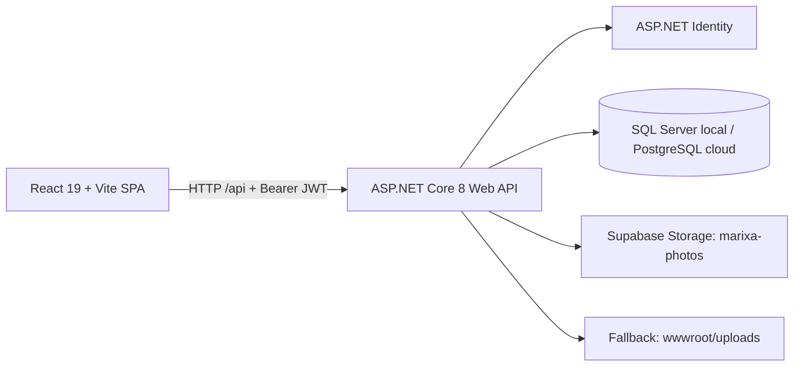

# 03 — Kiến trúc hệ thống Marixa

> Chủ tài liệu: **Đinh Văn Tài**. Đối chiếu mã nguồn: **16/10/2026**.
> **CURRENT** = có trong checkout; **TARGET** = thiết kế cần đạt; **NOT VERIFIED** = chưa kiểm tra runtime/hạ tầng. Có mã nguồn không đồng nghĩa đã nghiệm thu production.
> **EN — Codex / Agnes:** Read [00-README.md](00-README.md) first. Treat source links below as implementation evidence, not proof of production behavior. Preserve owner decisions; record security or architecture changes before implementation.

## 1. Thành phần và đường chạy hiện tại



| Thành phần | CURRENT — mã nguồn / cấu hình | Giới hạn xác minh |
| --- | --- | --- |
| Frontend | [`marixa_react/package.json`](../marixa_react/package.json): React 19, React Router 7, Vite 6; build static vào `dist/`. | Chưa chạy build/browser trong lượt chuẩn hóa tài liệu. |
| Backend | [`M.API/Program.cs`](../marixa_aspnet/M.API/Program.cs): controllers, EF Core, Identity/JWT, Swagger, static files, middleware lỗi. | Không khẳng định API đang truy cập được trên hosting. |
| CSDL | [`DatabaseConfig.cs`](../marixa_aspnet/M.API/Configuration/DatabaseConfig.cs): chọn provider qua `Database:Provider`, kết nối qua `ConnectionStrings:MyCnn`. | DB/schema live chưa đọc. |
| Ảnh chấm công | [`SupabaseStorageService.cs`](../marixa_aspnet/M.API/Storage/SupabasePhotoStorage.cs): khi đủ URL/service key, upload vào bucket public `marixa-photos`; thiếu cấu hình thì [`UploadController`](../marixa_aspnet/M.API/Controllers/Files/UploadController.cs) lưu đĩa local. | Không suy ra bucket/quyền live từ tên bucket trong code. |
| Triển khai | Cấu hình dự án dùng Render cho API, Vercel cho SPA, Supabase cho PostgreSQL/Storage. | Instance và cấu hình triển khai xem [08](08-deploy-detail.md), [11](11-setup-cloud.md); trạng thái online chưa kiểm tra. |

Frontend dùng [`apiConfig.js`](../marixa_react/src/services/api/apiConfig.js): `VITE_API_BASE_URL` nếu có, mặc định `/api`. Local có Vite proxy; triển khai web/API khác origin cần CORS đúng origin. [`axiosClient.js`](../marixa_react/src/services/api/axiosClient.js) đính Bearer token từ `marixa_auth` trong localStorage; HTTP 401 khi đang có token sẽ xóa phiên và chuyển về `/login`.

Ứng dụng dùng **ASP.NET Identity + JWT**, không dùng Supabase Auth cho phiên đăng nhập hiện tại. `marixa_aspnet/web` (Next.js cũ) đã bị xóa khỏi checkout; SQL/RPC của kiến trúc cũ không phải bằng chứng API .NET đang thực thi quy tắc đó.

## 2. Ranh giới mã nguồn

| Project / thư mục | Trách nhiệm |
| --- | --- |
| `marixa_aspnet/M.API` | HTTP controllers, đăng ký dịch vụ, auth, cấu hình DB, upload, seed, middleware. Một số controllers truy cập `DatabaseContext` trực tiếp. |
| `M.Contract.Services`, `M.Services` | Interface và xử lý nghiệp vụ/service, JWT, tính công. |
| `M.Contract.Repositories`, `M.Repositories` | Entity, repository/unit of work, EF `DatabaseContext`, migration. |
| `M.ModelViews`, `M.Core` | DTO request/response, phân trang, lỗi, hằng số dùng chung. |
| `marixa_react/src/modules` | Các module `login`, `activate`, `home`, `me`, `hr`, `admin`, `work`, `profile`, `unauthorized`. |
| `marixa_react/src/components`, `services`, `utils` | Layout/component dùng chung, API/auth/permission và tiện ích thời gian. |

Controllers hiện có bao phủ Identity/account, HR (nhân viên/phòng ban/chức vụ/hợp đồng/lương/bảo hiểm/thân nhân/ca/tài khoản ngân hàng), attendance/log/rule/correction, leave/ledger/OT, báo cáo/audit, work project/task/performance, payroll và danh mục. **Controller tồn tại chỉ xác nhận có bề mặt API**, không xác nhận toàn bộ UI, quyền hay quy tắc nghiệp vụ hoàn tất. Trạng thái theo module: [worklog.md](worklog.md); việc cần làm: [01-plan.md](01-plan.md).

## 3. Route frontend và quyền hiện tại

Nguồn route: [`App.jsx`](../marixa_react/src/App.jsx). Nguồn hiển thị module: [`modules.js`](../marixa_react/src/constants/modules.js). Inventory từng màn hình dùng cho thiết kế nằm ở [`figma/files-map.md`](../figma/files-map.md).

| Nhóm | Route hiển thị hiện có | Quyền / guard trong mã nguồn |
| --- | --- | --- |
| Public / tổng quan | `/login`, `/kich-hoat`, `/unauthorized`, `/home` | Không bọc `RequireModule` tại `App.jsx`; page/component có xử lý phiên riêng tùy nơi. |
| Cá nhân `me` | `/attendance`, `/attendance/attendance-history`, `/attendance/attendance-rules`, `/attendance/statistics`, `/attendance/leave`, `/attendance/contracts`, `/attendance/salary`, `/attendance/insurance`, `/attendance/bank-accounts` | Registry khai báo `access: user`; các route này không bọc `RequireModule` tại `App.jsx`. |
| Cá nhân có wrapper | `/attendance/reports`, `/attendance/promotions`, `/attendance/handover`, `/work` | Bọc `RequireModule`, registry là `access: user`. |
| Hồ sơ | `/profile` | Registry `access: user`, không bọc `RequireModule` tại `App.jsx`. |
| Nhân sự | `/employees`, `/employees/attendance-history`, `/employees/work-schedule`, `/employees/statistics`, `/employees/contracts`, `/employees/leaves`, `/employees/reports`, `/employees/accounts`, `/employees/promotions`, `/employees/handover` | Bọc `RequireModule`; registry cho `HR`, `Manager`, `Admin`. Đây không tự động cấp quyền cho mọi API đằng sau màn hình. |
| Admin có registry | `/admin`, `/admin/contracts`, `/admin/leaves`, `/admin/payroll`, `/admin/resigned`, `/admin/reports`, `/admin/accounts` | Bọc `RequireModule`; registry là `access: admin`, `ADMIN_ROLES = ["Admin"]`. |
| Admin thiếu registry | `/admin/work`, `/admin/roles`, `/admin/block-accounts`, `/admin/employees/leaves`, `/admin/employees/handover`, `/admin/employees/reports`, `/admin/employees/contracts` | Có wrapper nhưng không có mục tương ứng trong `MODULES`; `canAccessModule` hiện trả `true` khi không tìm thấy đường dẫn. Đây là khoảng trống cần sửa, không phải quyền được phê duyệt. |

[`permission.js`](../marixa_react/src/services/auth/permission.js) hiện chỉ kiểm tra role cho mục có `roles` hoặc `access: admin`; nhánh `access: user` và đường dẫn không đăng ký đều trả `true`, không kiểm tra token tại đây. [`RequireModule.jsx`](../marixa_react/src/components/common/RequireModule.jsx) chỉ chuyển tới `/unauthorized` khi hàm này trả `false`. **TARGET:** hoàn thiện kiểm tra phiên/route và kiểm tra quyền tại API; ẩn sidebar không phải biện pháp bảo vệ dữ liệu.

Redirect hiện tại, không phải màn hình riêng:

- `/` → `/home`; đường dẫn không khớp (`*`) → `/home`.
- `/finance` → `/attendance/salary`; `/employees/payroll` → `/employees`.
- `/admin/employees` → `/employees`; `/admin/employees/accounts` → `/admin/accounts`; `/admin/employees/promotions` → `/employees/promotions`.
- Các URL cũ `/attendance-history`, `/attendance-rules`, `/statistics`, `/leave`, `/reports`, `/promotions`, `/handover`, `/contracts`, `/salary`, `/insurance`, `/bank-accounts` chuyển sang URL cùng hậu tố dưới `/attendance`.

[`RoleSeeder.cs`](../marixa_aspnet/M.API/Seed/RoleSeeder.cs) khai báo 7 role: `Admin`, `Employee`, `Manager`, `HR`, `Accountant`, `Sale`, `Marketing`. Ba role mới chưa có quyền module chuyên biệt. Không tự diễn giải nhãn “Kế toán” của `/finance` thành phân hệ Accountant đã triển khai.

## 4. Hợp đồng HTTP đang có

### 4.1 Quy ước và ngoại lệ

- Route API phổ biến là `api/[controller]`, không có prefix `/api/v1` trong đường chạy này. Đọc controller/DTO cụ thể hoặc Swagger của instance đang thử để biết method và payload.
- Thành công thường trả [`BaseResponse<T>`](../marixa_aspnet/M.Core/Base/BaseResponse.cs): `data`, `message`, `statusCode`, `code`. `code` chưa thống nhất: controller có thể dùng `SUCCESS`, helper `OkResponse` dùng `OK`.
- [`BasePaginatedList<T>`](../marixa_aspnet/M.Core/Base/BasePaginatedList.cs) gồm `items`, `totalItems`, `currentPage`, `totalPages`, `pageSize`, `hasPreviousPage`, `hasNextPage`; không áp dụng cho mọi list API.
- [`ExceptionMiddleware.cs`](../marixa_aspnet/M.API/Middleware/ExceptionMiddleware.cs) chuyển `ErrorException` thành HTTP status tương ứng và envelope lỗi; exception khác thành HTTP 500/envelope chung. Lỗi model validation của `[ApiController]`, auth challenge/forbid và controller trả trực tiếp `BadRequest(string)`, `NotFound()` hoặc file có thể khác envelope.
- **Upload/photo hiện trả HTTP 200 cả khi body `statusCode` là 400/500.** Frontend phải đọc body; không chỉ dựa vào HTTP 2xx hoặc chuỗi `code = SUCCESS`.

### 4.2 Điểm vào quan trọng và quyền xác nhận tĩnh

| Endpoint | Đầu vào / kết quả chính | CURRENT — kiểm soát quyền / chú ý |
| --- | --- | --- |
| `POST /api/Auth/login` | DTO login → token + thông tin user/employee/roles. | Không có `[Authorize]`; đăng nhập do `AuthService` xử lý. |
| `POST /api/Auth/register`, `POST /api/Auth/activate` | DTO đăng ký / mã kích hoạt + mật khẩu. | Không có `[Authorize]`; không suy ra UI tự đăng ký đã có từ endpoint. |
| `POST /api/Auth/change-password` | DTO đổi mật khẩu. | Action hiện thiếu `[Authorize]`; service nhận `UserId` từ body và kiểm tra mật khẩu cũ, chưa ràng buộc user đó với JWT. Cần rà soát/bổ sung bảo vệ theo [01](01-plan.md), không coi chú thích “đã xác thực” là bằng chứng. |
| `POST /api/Upload/photo?type=checkin` hoặc `checkout` | `multipart/form-data`, field `file`; `.jpg/.jpeg/.png/.webp`, tối đa **5 MiB** → `data` là URL/path ảnh. | `[Authorize]`; kiểm tra extension/size, không có bằng chứng kiểm tra nội dung ảnh hoàn chỉnh. Không gán Content-Type cố định làm mất multipart boundary. |
| `POST /api/Attendance/checkin` | `employeeId`, `type` (`1` vào / `2` ra), tùy chọn `method`, `photoUrl`, `note` → `alreadyRecorded`, `message`, `attendance`. | Controller `[Authorize]`; service kiểm tra nhân viên tồn tại nhưng chưa ràng buộc `employeeId` với user đang gọi. DTO không nhận tọa độ GPS. |
| `GET /api/Attendance/by-employee/{employeeId}`, `GET /api/Attendance/get-by-id/{id}` | Danh sách theo nhân viên / bản ghi. | `[Authorize]`; chưa có kiểm tra quyền sở hữu tại các service tương ứng. |
| `GET /api/Attendance/get-all`; `POST create/approve`, `PUT update`, `DELETE soft-delete/{id}` hoặc `delete/{id}` dưới `/api/Attendance` | Quản trị/chỉnh/duyệt/xóa công. | Action yêu cầu `Admin,Manager,HR`; phạm vi nhân viên/phòng ban phải rà soát riêng, không mặc định có scoping. |
| `GET /api/AttendanceRulePublic/active` | Các rule active. | Có `[Authorize]` dù tên controller chứa `Public`; không phải anonymous API. |
| `/api/LeaveRequest/*`, `/api/OvertimeRequest/*` | Tạo, đọc, đổi trạng thái đơn. | Có role/owner/status check theo action và service, không đồng nhất giữa leave và OT; xem [02](02-business-analysis.md), [05](05-workflow.md). |
| `/api/EmployeeReport/*` | Upload/phiên bản/duyệt/tải file báo cáo. | Có kiểm tra người sở hữu/người quản lý theo luồng; tải file và lỗi trực tiếp khác envelope chuẩn. Không phải export bảng công snapshot. |

Ví dụ payload **hiện tại** cho API chấm công (GUID minh họa, không phải dữ liệu thật):

```json
{
  "employeeId": "11111111-1111-1111-1111-111111111111",
  "type": 1,
  "method": 4,
  "photoUrl": "/uploads/attendance/checkin/202610/example.jpg",
  "note": null
}
```

`method = 4` là `Phone` mặc định. Request không truyền thời gian log hoặc ngày công: service dùng UTC máy chủ. Trong 2 phút có log cùng loại, API trả `alreadyRecorded = true` với bản ghi hiện có; đây là chống bấm lặp ở service, **chưa phải idempotency key hoặc bảo đảm chống race tại DB**. Lỗi nhân viên không tồn tại ném HTTP 404 với `code = NOT_FOUND`. Nguồn DTO: [`AttendanceModelView.cs`](../marixa_aspnet/M.ModelViews/AttendanceModelView/AttendanceModelView.cs); xử lý: [`AttendanceService.cs`](../marixa_aspnet/M.Services/Services/Timekeeping/AttendanceService.cs).

### 4.3 Bảo mật cần hoàn thiện

**TARGET:** API phải quyết định quyền dựa trên JWT hợp lệ, role và quyền sở hữu/phạm vi quản lý; client ids và localStorage không phải nguồn cấp quyền. Các lỗ hổng route/ownership/change-password ở trên là việc cần xử lý, không được “chuẩn hóa” thành quy tắc nghiệp vụ hợp lệ. Ma trận endpoint/role/scope cần mở rộng khi sửa từng module và kèm test HTTP 401/403/cross-user. Không khẳng định toàn API đã audit bảo mật.

## 5. Thời gian, bootstrap và tính nhất quán

| Chủ đề | CURRENT | TARGET / giới hạn |
| --- | --- | --- |
| Timestamp | Chấm công dùng UTC; nhiều chỗ hiển thị qua [`vnTime.js`](../marixa_react/src/utils/vnTime.js). | Ngày nghiệp vụ phải thống nhất `Asia/Ho_Chi_Minh`. |
| Ngày công | `AttendanceService.CheckInAsync` tìm/tạo `AttendanceDate = DateTime.UtcNow.Date`. Một số phép chọn “hôm nay” ở UI dùng timezone trình duyệt. | Sai khác với ngày Việt Nam vào 00:00–06:59 UTC+7; cần sửa và test biên giờ, không gọi đây là hành vi đúng. |
| Rule/ca | Tính giờ/OT đọc rule active; trạng thái đúng/trễ dùng `PlannedShift` hoặc ca fallback; các đường xử lý chưa dùng một nguồn thống nhất. | Xem công thức và sai khác ở [02](02-business-analysis.md), [04](04-database-design.md). |
| Khởi động | SQL Server chạy EF migrations. PostgreSQL chạy DDL tạo từ EF, xử lý statement và bổ sung cột qua `PostgresSchemaSync`; startup ghi cảnh báo khi bước DB/seed lỗi. | Không thay thế migration/backfill/rollback; API boot được không chứng minh DB đầy đủ. |
| Seed | `RoleSeeder`, `AttendanceRuleSeeder`, `AdminSeeder`, `SampleDataSeeder` được gọi khi boot. `SampleDataSeeder` không chỉ giới hạn ở Development. | `AttendanceRuleSeeder` ghi lại nhiều trường của `DEFAULT-CA` đã tồn tại; không gọi toàn bộ seed là “chỉ tạo nếu thiếu”. |
| Offline / khóa kỳ | Chưa có queue IndexedDB; chưa có khóa kỳ + snapshot bảng công + export snapshot XLSX/PDF. | Luồng tương lai ở [05](05-workflow.md); kiểm thử ở [06](06-testing.md). |

## 6. Cách mở rộng có kiểm soát

Khi sửa một module: đọc route → caller API → DTO/controller → service → entity/EF; ghi rõ request, response, role, owner/scope, transition và lỗi có thể xảy ra. Cập nhật tài liệu cùng thay đổi đã được giao; thay đổi quyết định nghiệp vụ/bảo mật/kiến trúc phải có quyết định của chủ dự án trong [01](01-plan.md)/[worklog](worklog.md). Kiểm tra code/build/test phù hợp trước khi ghi hoàn thành. Chưa chạy runtime, DB live hoặc Figma thì giữ nhãn **NOT VERIFIED**.

Liên quan: [04 — Dữ liệu](04-database-design.md), [09 — UI](09-ui-design.md), [10 — Local](10-setup-local.md), [13 — Figma](13-figma-sync.md).
