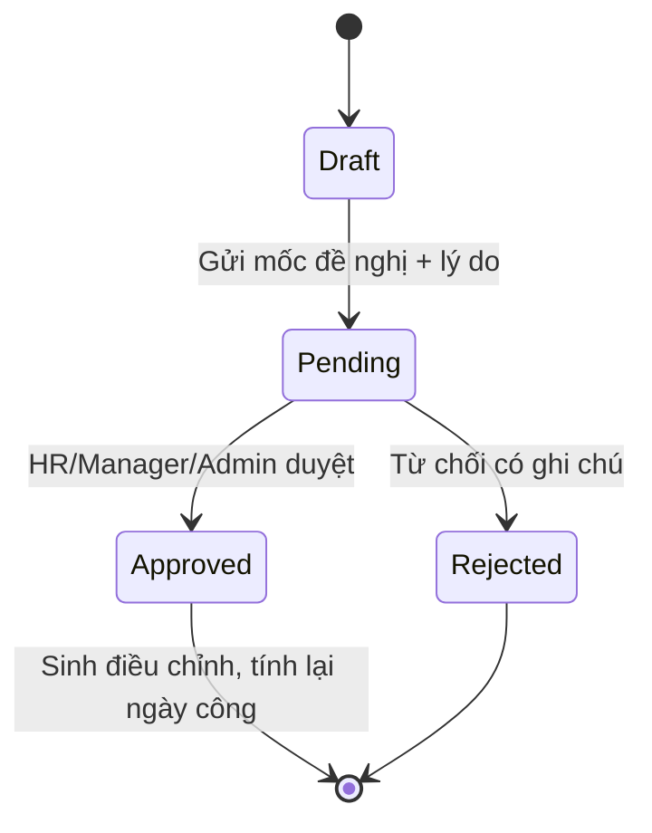
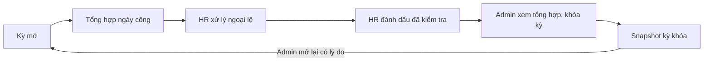

# 03 — Luồng nghiệp vụ hệ thống chấm công Marixa

> Tác giả & chủ tài liệu: **Đinh Văn Tài**.
> Mô tả luồng chấm công, nghỉ phép/tăng ca/sửa công, khóa kỳ và các trạng thái lỗi — **khớp với code đang chạy** (`M.API` controllers/services + `marixa_react` modules).

## 0. Cách đọc (dành cho AI)

- Mỗi mục = một luồng; đọc theo thứ tự khi muốn biết "mấy ai chạm, đi qua endpoint nào".
- Endpoint cụ thể: backend có route `[Route("api/[controller]")]`, controller trong `M.API/Controllers` & `M.API/AuthController`. Frontend gọi qua `marixa_react/src/services/api/axiosClient.js` (Bearer token).

## 1. Chấm vào / chấm ra

```mermaid
flowchart TD
  A[NV/HR mở trang /attendance] --> B{Đã có lượt hợp lệ hôm nay?}
  B -- Chưa vào --> C[Chấm VÀO ca]
  B -- Đã vào, chưa ra --> D[Chấm RA ca]
  B -- Đủ 2 lượt --> E[Xem lịch sử / yêu cầu sửa]
  C --> F[Chụp camera + GPS nếu được]
  D --> F
  F --> I[Preview, chụp lại nếu cần]
  I --> J[Gửi POST /api/Attendance/checkin (+ upload ảnh POST /api/Upload/photo)]
  J --> K{Server nhận?}
  K -- Có --> L[Ghi Attendance + AttendanceLog, tính giờ thực tế/tăng ca]
  K -- Lỗi --> M[Hướng dẫn kiểm tra mạng/quyền camera]
```

Điểm chính trong code:
- `AttendanceService.CheckInAsync`: tự tạo `Attendance` của ngày nếu chưa có, thêm `AttendanceLog`, chặn trùng khi đã có log cùng loại trong cửa sổ ~2 phút, tính `ActualHours`/`OvertimeHours` theo `AttendanceRule` active, tự đánh `Late`/`Present`.
- Ảnh: `CameraCapture.jsx` (webcam) → `POST /api/Upload/photo` (Supabase Storage nếu prod, đĩa nếu dev). GPS: nếu có quyền thì lưu; **thiếu camera/GPS vẫn chấm được** (bằng chứng tùy chọn).
- Chấm ngoài văn phòng: gắn cờ tham chiếu nếu có `OfficeLocation` + GPS; **không chặn chấm công**.

## 2. HR đối soát công bất thường

Danh sách HR ưu tiên: thiếu mốc, đi trễ/về sớm, ngoài văn phòng, ảnh lỗi/đủ, trùng log. HR mở chi tiết, xem giờ thiết bị/máy chủ, ảnh; ghi kết quả `đã kiểm tra` hoặc `cần bổ sung`. Việc kiểm tra không sửa event gốc. Ảnh lỗi phải xử lý trước khi khóa kỳ hoặc ghi ngoại lệ có lý do.

## 3. Yêu cầu sửa công



Người dùng chỉ gửi yêu cầu cho ngày của mình. Khi duyệt, tạo `AttendanceCorrection` riêng và audit trước/sau; không ghi đè log gốc.

## 4. Đơn nghỉ và sổ phép

Người dùng tạo nháp → chọn loại nghỉ (`LeaveType`), ngày, lý do → gửi. Người duyệt: HR/Manager/Admin (người gửi không tự duyệt). Duyệt nghỉ phép năm tạo giao dịch trừ `LeaveLedger` đúng một lần; từ chối không trừ; hủy đơn đã duyệt sinh giao dịch hoàn. PDF đơn nghỉ (nếu có) phản ánh phiên bản/trạng thái tại thời điểm xuất.

## 5. Yêu cầu tăng ca

Nhập ngày, khoảng giờ, lý do. Duyệt trước khi tính. Sau phê duyệt, bảng công chỉ cộng phần giao giữa giờ tăng ca được duyệt và giờ chấm thực tế. Không tự tính tăng ca chỉ vì ra muộn.

## 6. Chốt kỳ tháng



Kỳ mở tính lại khi có chấm/đơn/điều chỉnh mới. Dữ liệu phát sinh sau khóa không âm thầm đổi snapshot cũ; mở lại kỳ có audit + phiên bản mới.

## 7. Trạng thái & lỗi cần hiển thị

| Tình huống | Phản hồi người dùng | Xử lý dữ liệu |
| --- | --- | --- |
| Camera/GPS bị từ chối | Hướng dẫn cấp quyền; vẫn chấm được | Không tạo event thiếu bằng chứng một cách âm thầm |
| Mất mạng | "Thử lại khi có mạng" | Giữ thao tác, retry |
| Chấm trùng gần đây | "Đã có lần chấm gần đây, không cần bấm lại" | Không nhân đôi log |
| Chấm ngoài văn phòng | "Đã ghi nhận – HR kiểm tra vị trí" | Gắn cờ, không tự đánh vắng |
| Thiếu chấm ra | "Ngày công chưa hoàn chỉnh" | Chờ lượt ra hoặc sửa công |
| Kỳ đã khóa | "Kỳ công đã khóa" | Chặn thay đổi đến khi admin mở lại |

Chi tiết trường dữ liệu ở [02-database-design.md](02-database-design.md); kịch bản test ở [05-testing-strategy.md](05-testing-strategy.md).
