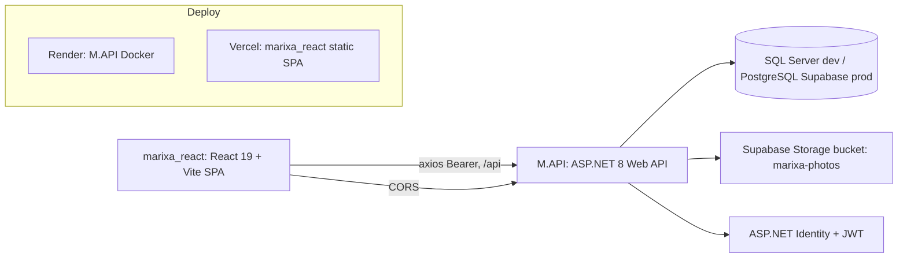

# 04 — Kiến trúc hệ thống chấm công Marixa

> Tác giả & chủ tài liệu: **Đinh Văn Tài**.
> Kiến trúc **đang chạy thực tế** của repo: backend **ASP.NET Core 8 Web API** (`marixa_aspnet/M.API`), frontend **React 19 + Vite SPA** (`marixa_react`), CSDL **SQL Server (dev) / PostgreSQL Supabase (prod)** qua lớp DB linh hoạt, deploy **Render (API) + Vercel (web)** + **Supabase Storage (ảnh)**.

## 0. Cách đọc (dành cho AI)

- Đây là "bản đồ hệ thống": backend nào, frontend nào, dữ liệu ở đâu, deploy ra đâu.
- Để biết chi tiết config Render/Supabase/Vercel: xem `08-database-flexible-deployment.md` và `SETUP_CLOUD.md`.
- Để biết module/trang nào đã làm: xem `docs/worklog.md`.

## 1. Kiến trúc tổng quan

- **Frontend** (`marixa_react`): React 19 + Vite + React Router 7. Build static (`npm run build` → `dist/`), deploy Vercel. Gọi backend bằng `VITE_API_BASE_URL` (cross-origin, bật CORS).
- **Backend** (`marixa_aspnet/M.API`): ASP.NET Core 8, EF Core, JWT Bearer, Swagger. Chạy trong Docker trên Render (Web service, `render.yaml`).
- **DB linh hoạt**: đọc qua `M.API/DatabaseConfig.cs` (env `DATABASE__PROVIDER`, `CONNECTIONSTRINGS__MYCNN`). Dev = SQL Server, Prod = PostgreSQL (Supabase session pooler). URI Postgres được normalize bằng `NpgsqlConnectionStringNormalizer`.
- **Ảnh**: `SupabaseStorageService` upload bucket public `marixa-photos` khi đã set `SUPABASE__URL` + `SUPABASE__SERVICE_KEY`; chưa set thì fallback `wwwroot/uploads`.

> **Docker chỉ dùng cho build/chạy API trên Render** (theo `render.yaml` + `marixa_aspnet/Dockerfile`). Phát triển local chạy .NET trực tiếp (không cần Docker cho dev web/DB).

## 2. Phân hệ (theo controllers/services thật)

| Phân hệ | Controllers / Services chính | Trách nhiệm |
| --- | --- | --- |
| Identity & Account | `AuthController`, `UserLoginController`, `RoleController`, `UserController`, `UserRoleController` | Login (username/email/sđt), register, activate (mã kích hoạt), đổi mật khẩu, link Google, quản lý role/user. |
| Employee / HR | `EmployeeController`, `DepartmentController`, `PositionController`, `EmployeeContract/Insurance/Salary/Dependent/Shift/BankAccount` | Hồ sơ nhân sự, phòng ban, hợp đồng, bảo hiểm, lương, thân nhân, ca. |
| Attendance | `AttendanceController`, `AttendanceLogController`, `AttendanceRuleController`, `AttendanceRulePublicController`, `AttendanceCorrectionController` | Chấm vào/ra, log, quy tắc ca, sửa công. |
| Leave & Overtime | `LeaveRequestController`, `LeaveTypeController`, `LeaveLedgerController`, `OvertimeRequestController` | Đơn nghỉ, loại nghỉ, sổ phép, tăng ca. |
| Reports & Audit | `EmployeeReportController`, `AuditLogController` | Báo cáo theo kỳ, nhật ký thay đổi. |
| Admin | `ActivationCodeController`, seeder | Cấp mã kích hoạt, seed role/admin/quy tắc/dữ liệu mẫu. |
| Work (đặc tả mở rộng) | `WorkProjectController`, `WorkTaskController`, `WorkPerformanceController` | Dự án công việc, task, hiệu suất. |
| Payroll | `PayrollController`, `SalaryGroupController`, `BankController` | Bảng lương, nhóm lương, ngân hàng. |

Seeder chạy khi boot (idempotent): `RoleSeeder`, `AttendanceRuleSeeder`, `AdminSeeder`, `SampleDataSeeder` (dữ liệu mẫu dev).

## 3. Route giao diện (frontend `marixa_react`)

Từ `marixa_react/src/App.jsx` và `constants/modules.js`:

| Route | Người dùng | Nội dung |
| --- | --- | --- |
| `/login` | Chưa đăng nhập | Đăng nhập (username/sđt/email + mật khẩu). |
| `/kich-hoat` | Tài khoản mới | Kích hoạt bằng mã, đặt mật khẩu. |
| `/home` | Đã đăng nhập | Trang tổng quan (module cards). |
| `/attendance`, `/attendance/attendance-history`, `/attendance/statistics`, `/attendance/leave`, `/attendance/salary`, `/attendance/contracts`, `/attendance/insurance`, `/attendance/bank-accounts`, `/attendance/attendance-rules`, `/attendance/reports`, `/attendance/promotions`, `/attendance/handover` | Nhân viên (module `me`) | Chấm công, lịch sử, thống kê, nghỉ phép, lương, hợp đồng, BHXH, tài khoản NG, quy định, báo cáo, thăng chức, bàn giao. |
| `/work`, `/profile` | Đã đăng nhập | Công việc, hồ sơ cá nhân. |
| `/employees`, `/employees/attendance-history`, `/employees/work-schedule`, `/employees/statistics`, `/employees/contracts`, `/employees/leaves`, `/employees/reports`, `/employees/accounts`, `/employees/promotions`, `/employees/handover` | HR / Manager / Admin | Quản lý nhân sự, đối soát, duyệt. |
| `/admin`, `/admin/contracts`, `/admin/leaves`, `/admin/payroll`, `/admin/resigned`, `/admin/reports`, `/admin/accounts`, `/admin/work`, `/admin/roles`, `/admin/block-accounts`, `/admin/employees/*` | Admin | Dashboard, cấu hình, tài khoản, role, khóa tài khoản, hợp đồng, nghỉ phép, lương, nghỉ việc, báo cáo. |

Phân quyền route guard bằng `RequireModule` + `canAccessModule` (đọc `MODULES`); backend vẫn là nguồn quyền thật.

## 4. Hợp đồng API

- Backend route chung: `[Route("api/[controller]")]`, ví dụ `/api/Attendance/checkin`, `/api/Upload/photo`, `/api/Auth/login`, `/api/LeaveRequest/...`, `/api/Role/...`.
- Chuẩn response: `BaseResponse<T>` / `BasePaginatedList<T>` (statusCode, code, message, data).
- Auth: JWT Bearer (phát hành qua `M.Services/Security/JwtGenerator.cs`). Endpoint công khai: `Auth/login`, `Auth/activate`, `Auth/register`.
- Upload ảnh: multipart, giới hạn 5 MB, chấp nhận `jpg/jpeg/png/webp`.

> Ghi chú: tài liệu cũ mô tả endpoint `/api/v1/...` (kiến trúc Next.js Route Handler). Repo hiện chạy **không có Next.js backend**; nếu muốn dùng lại bộ API `/api/v1` + Supabase Auth/RLS (bản `marixa_aspnet/web` Next.js), cần một quyết định rõ của chủ dự án và cập nhật mục này.

## 5. Thời gian & offline

- Máy chủ lưu UTC; hiển thị quy đổi `Asia/Ho_Chi_Minh` (frontend `marixa_react/src/utils/vnTime.js`).
- Chấm offline (mất mạng) chưa có hàng đợi IndexedDB trong V1 (xem `worklog.md` mục chức năng chưa có).

## 6. Quan sát & hiệu năng

- Ghi log có mã lỗi, độ trễ; không ghi mật khẩu/GPS thô vào log.
- Ảnh upload bounded (5 MB); bảng danh sách phân trang.

Chi tiết dữ liệu ở [02-database-design.md](02-database-design.md), UI ở [07-ui-design-system.md](07-ui-design-system.md), triển khai chi tiết ở [08-database-flexible-deployment.md](08-database-flexible-deployment.md).
