# MARIXA — Thư viện ảnh chức năng

[Mở demo](https://marixa001.vercel.app/) · [Quay lại README](../README.md)

Ảnh chụp trực tiếp ngày **04/11/2026** từ bản demo do chủ dự án cung cấp. Desktop dùng viewport 1440 × 1000; mobile dùng 390 × 844. Ảnh toàn trang có thể cao hơn viewport.

Phần lớn màn hình nghiệp vụ được khảo sát bằng tài khoản Admin mẫu `0900000006`. Đăng nhập Nhân viên, HR và Quản lý cũng đã thành công. Các ảnh phản ánh giao diện tại thời điểm chụp, không chứng minh mọi thao tác ghi dữ liệu đã được kiểm thử. Không dùng token hoặc trạng thái phiên đăng nhập làm tài nguyên tài liệu.

## Đăng nhập

Trang đăng nhập có lựa chọn ngôn ngữ và liên kết kích hoạt tài khoản. [Mở màn hình demo](https://marixa001.vercel.app/login).

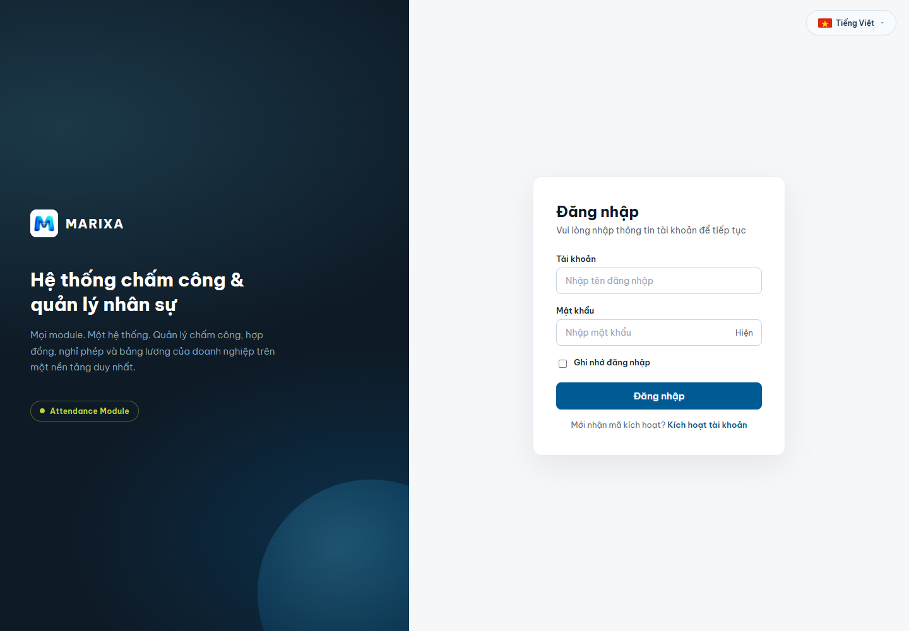

## Không gian làm việc

Các module hiển thị theo quyền. Ảnh này dùng tài khoản Admin; nhân viên có ít module hơn. [Mở màn hình demo](https://marixa001.vercel.app/home).

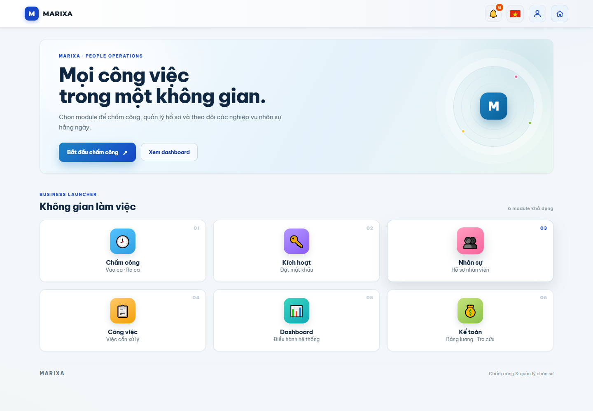

## Dashboard quản trị

Biểu đồ check-in bảy ngày và lối tắt đến các nhóm quản trị. [Mở màn hình demo](https://marixa001.vercel.app/admin).

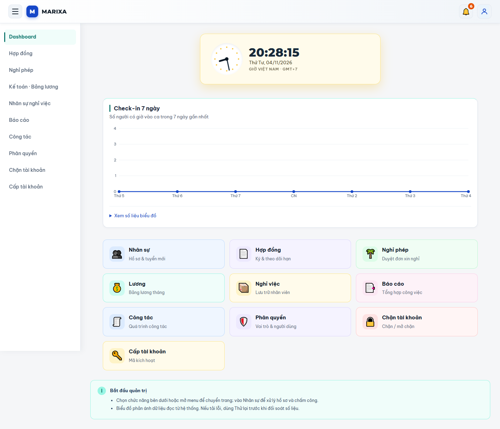

## Danh sách nhân sự

Tìm kiếm, bộ lọc phòng ban/trạng thái và mức độ hoàn thiện hồ sơ; có hồ sơ gắn nhãn DEMO. [Mở màn hình demo](https://marixa001.vercel.app/hr).

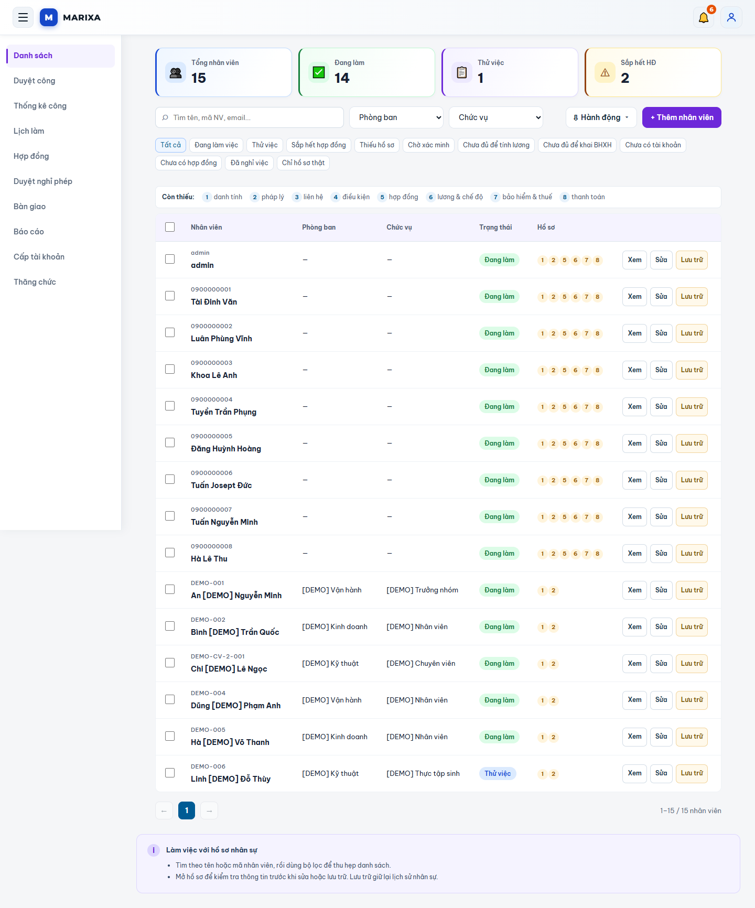

## Lịch làm việc

Lịch tháng, số người có lịch và danh sách ca theo ngày. [Mở màn hình demo](https://marixa001.vercel.app/hr/work-schedule).

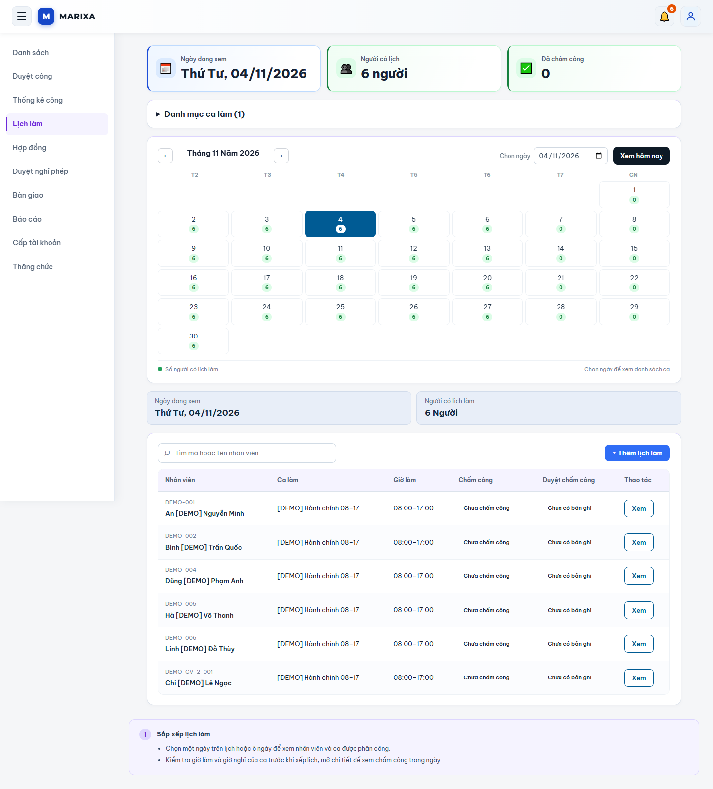

## Chấm công cá nhân

Trạng thái vào/ra ca, chụp ảnh, định vị tùy chọn và lịch tuần. Màn hình được mở bằng tài khoản Admin; chưa bấm ghi công hoặc cấp quyền camera/GPS. [Mở màn hình demo](https://marixa001.vercel.app/me).

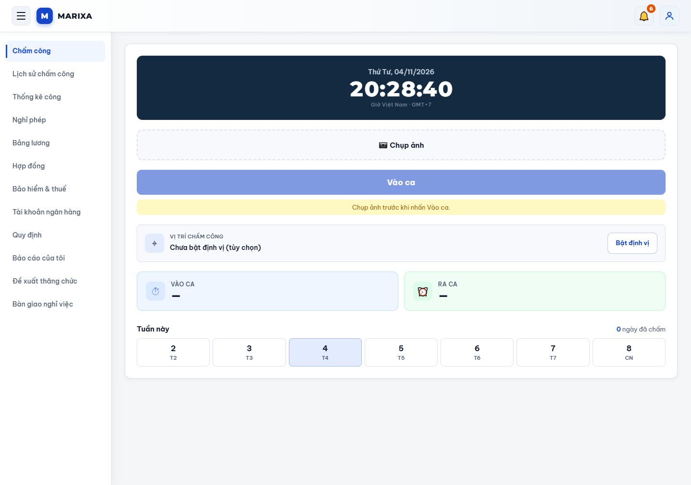

## Nghỉ phép

Đơn theo trạng thái, số ngày, lý do mẫu và thao tác xử lý theo quyền. Có nút hủy đơn đã duyệt trên live; chưa kiểm thử thao tác hủy. [Mở màn hình demo](https://marixa001.vercel.app/hr/leaves).

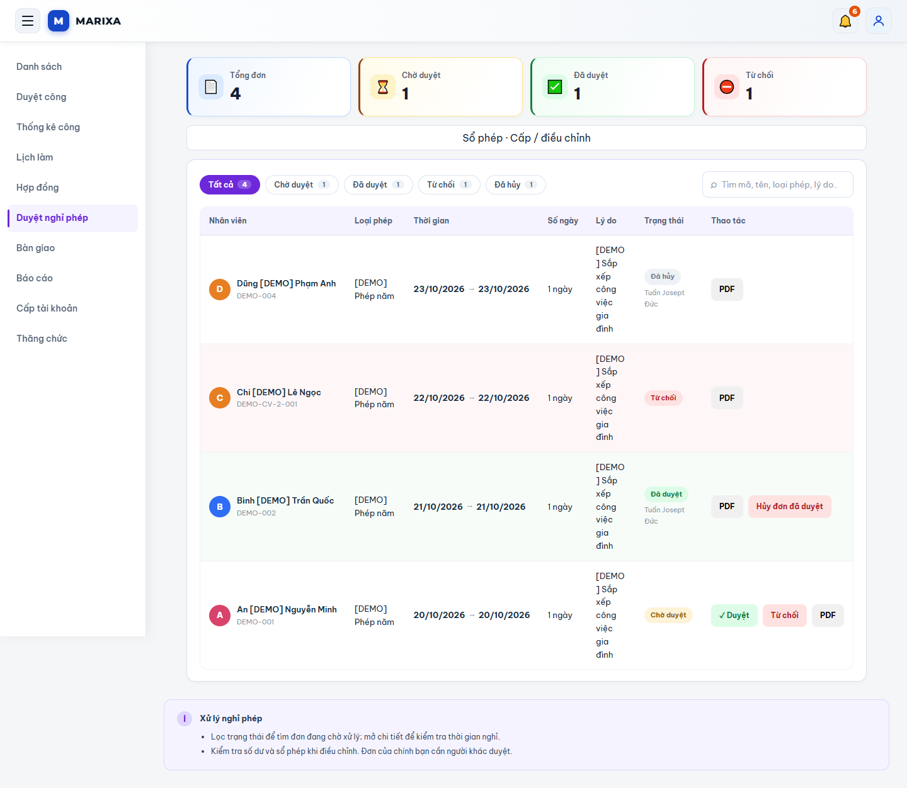

## Hợp đồng

Theo dõi hợp đồng đã ký, sắp hết hạn và hồ sơ chưa lập hợp đồng. [Mở màn hình demo](https://marixa001.vercel.app/hr/contracts).

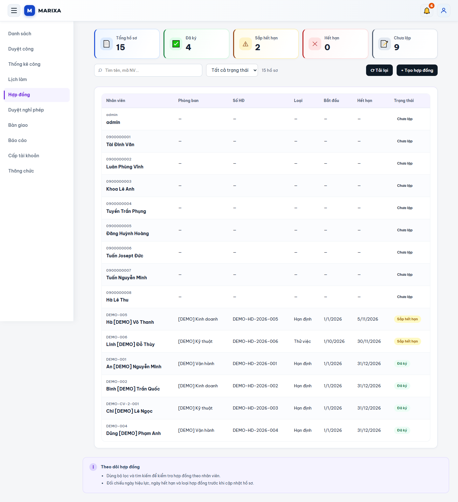

## Tổng quan kế toán

Tổng hợp phiếu lương theo trạng thái. Giao diện live ghi rõ chỉ phục vụ tra cứu. [Mở màn hình demo](https://marixa001.vercel.app/accounting).

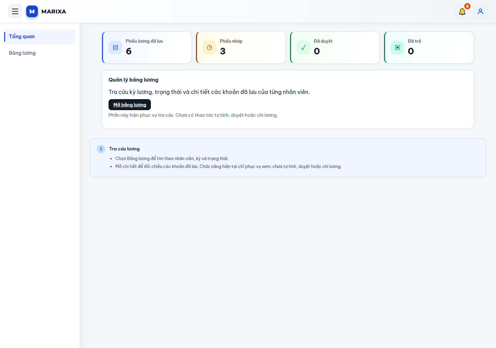

## Bảng lương

Lọc nhân viên/kỳ/trạng thái và mở phiếu đã lưu. Các số tiền trong ảnh thuộc các dòng gắn nhãn DEMO; chưa thử tính, duyệt hoặc chi lương. [Mở màn hình demo](https://marixa001.vercel.app/accounting/payroll).

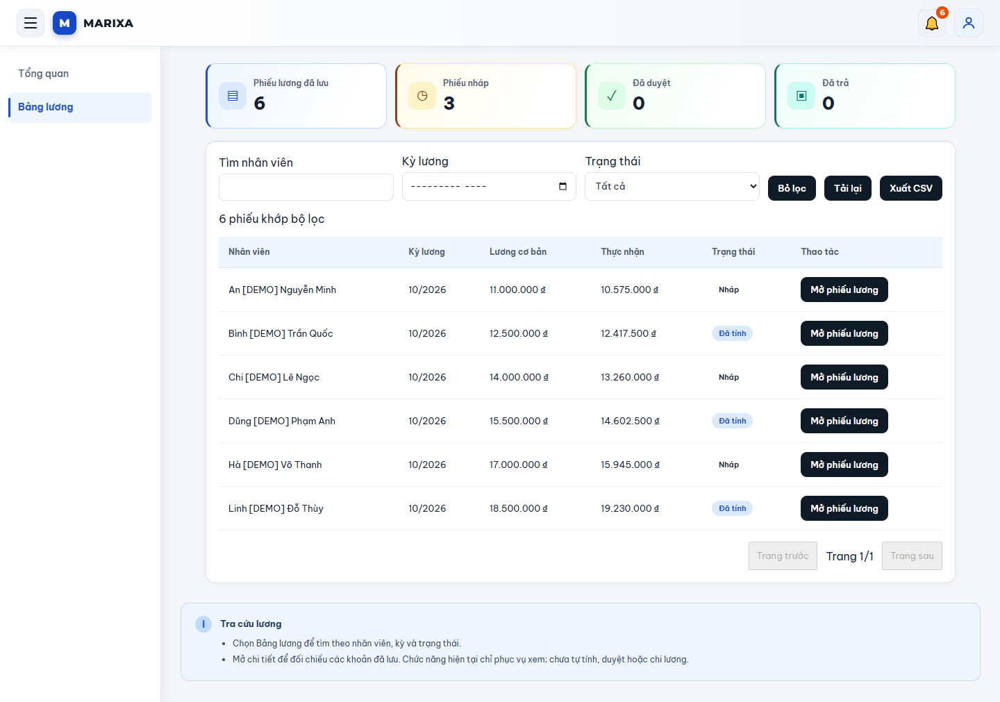

## Công việc

Tổng quan việc hôm nay, dự án, tiến độ và hiệu suất. Ảnh tài khoản Admin hiện chưa có nhiệm vụ trong tuần. [Mở màn hình demo](https://marixa001.vercel.app/work).

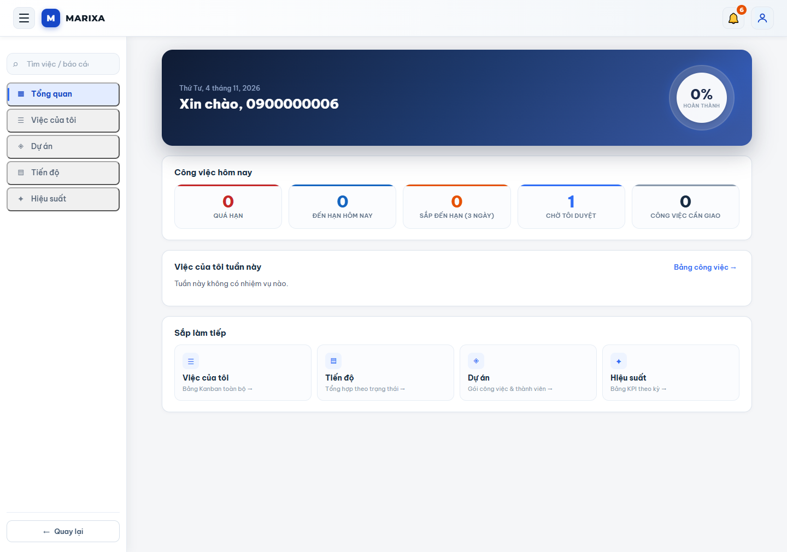

## Giao diện mobile

Trang đăng nhập và trang chấm công được chụp ở chiều rộng 390 px. Chưa kiểm thử camera/GPS trên điện thoại thực.

| Đăng nhập | Chấm công |
| --- | --- |
| 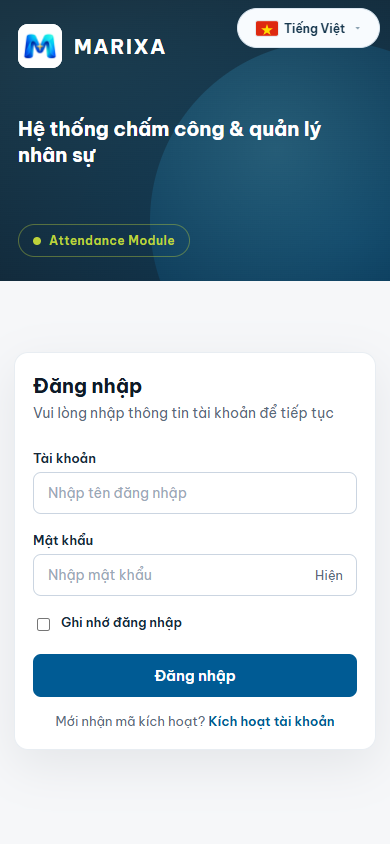 | 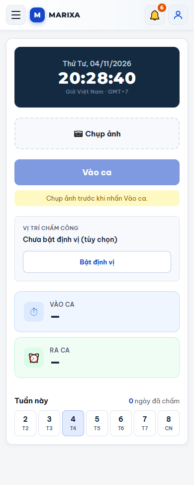 |

## Phạm vi kiểm tra

- Xác nhận trang đăng nhập và điều hướng một số module sau đăng nhập.
- Đăng nhập UI thành công: `0900000001`, `0900000003`, `0900000005`, `0900000006`.
- API đăng nhập trả HTTP 200: `0900000002`, `0900000004`, `0900000008`; chưa duyệt giao diện từng tài khoản này.
- `0900000007` bị từ chối với mật khẩu seed; không tự đặt lại mật khẩu.
- Chỉ khảo sát màn hình; không tạo/xóa nhân viên, gửi/duyệt đơn, ghi công, đổi quyền hoặc thay đổi bảng lương.
- Ảnh ghi lại demo ngày 04/11/2026; chưa xác nhận mã commit đang triển khai. Hướng dẫn chạy local dùng tài liệu main hiện hành.
